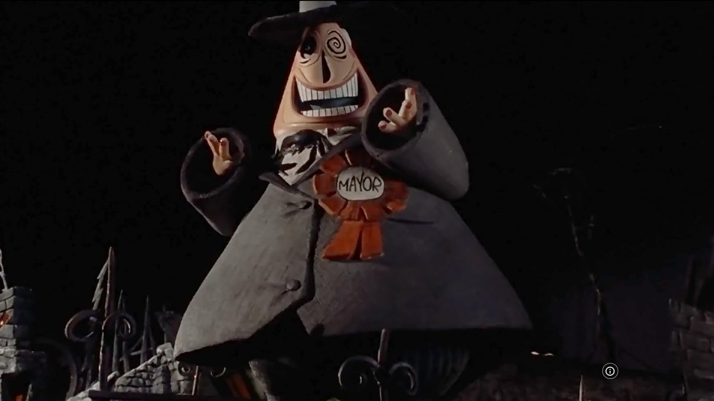
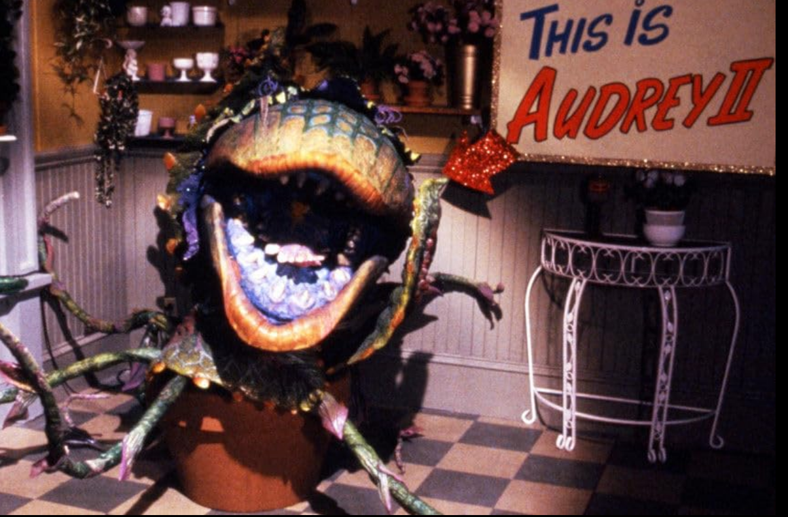
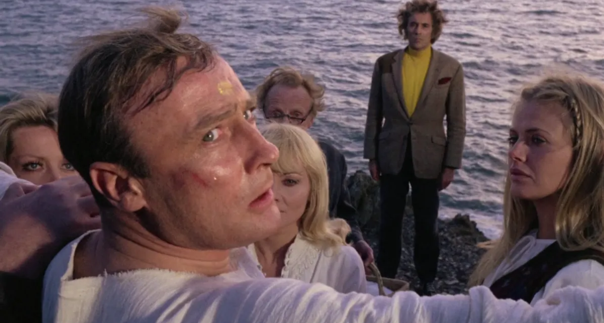

# Partie 1 - Hmmm, en fait...

...Quelques affirmations qui sont *presque* correctes. 

**Un point pour trouver l'erreur et deux points pour la corriger!**

## Exemple

::::{.qa}
:::{.question}

D'abord fondée en 1878 comme un campus francophone de l'Université McGill, l'Université de Montréal devient un établissement indépendant en 1919 et 1920 quand elle reçoit une charte papale, puis provinciale lui permettant de décerner ses propres diplômes. 

:::
::: {.answer .fragment}

D'abord fondée en 1878 comme un campus francophone de l'==Université ~~McGill~~ Laval==, l'Université de Montréal devient un établissement indépendant en 1919 et 1920 quand elle reçoit une charte papale, puis provinciale lui permettant de décerner ses propres diplômes. 

:::
::::

## Première affirmation

::::{.qa}
:::{.question}

Fondée en par les professeurs Édouard Pagé et Paul Pirlot, la Station de biologie des Laurentides (SBL) ouvre ses portes à la recherche en 1965 sur un terrain forestier appartenant à la Couronne. Aujourd'hui, elle est dirigée par Colin Favret et gérée par Gabriel Labrie.

:::
::: {.answer .fragment}

Fondée en par les professeurs Édouard Pagé et Paul Pirlot, la Station de biologie des Laurentides (SBL) ouvre ses portes à la recherche en 1965 sur un terrain forestier appartenant à la Couronne. Aujourd'hui, elle est dirigée par Colin Favret et gérée par ==Gabriel ~~Labrie~~ Lanthier==.

:::
::::

## Seconde affirmation

::::{.qa}
:::{.question}

Depuis 2025, le champion du monde du jeu de société d'origine française *Les Colons de Catane* est le canadien Kohulan Narendran. Le jeu a été traduit dans plus de 30 langages et se joue généralement à quatre et le premier joueur à atteindre 10 points gagne automatiquement la partie. Il existe plusieurs sources de points\ : les colonies (1 pt), les villes (2pt) et les cartes développements "point de victoire" (1pt). De plus, avoir la route la plus longue ou l'armée la plus puissante donne 2 points.

:::
::: {.answer .fragment}

Depuis 2025, le champion du monde du ==jeu de société ~~d'origine française *Les Colons de Catane*~~ d'origine allemande *Die Siedler von Catan*== est le canadien Kohulan Narendran. Le jeu a été traduit dans plus de 30 langages et se joue généralement à quatre et le premier joueur à atteindre 10 points gagne automatiquement la partie. Il existe plusieurs sources de points\ : les colonies (1 pt), les villes (2pt) et les cartes développements "point de victoire" (1pt). De plus, avoir la route la plus longue ou l'armée la plus puissante donne 2 points.

:::
::::

## Troisième affirmation

::::{.qa}
:::{.question}

Depuis 2009, des buses à épaulettes nichent au sommet de la tour du Pavillon Roger-Gaudry de l'Université de Montréal dans un nichoir artificiel. La première éclosion est celle de Polly qui passe une saison aux côtés de ses parents avant de déménager sous l'échangeur Turcot. Elle fut repérée pour la dernière fois il y a six ans en train de dévorer un goéland au Parc Angrignon. 

:::
::: {.answer .fragment}

Depuis 2009, des ==~~buses à épaulettes~~ faucons pélerins== nichent au sommet de la tour du Pavillon Roger-Gaudry de l'Université de Montréal dans un nichoir artificiel. La première éclosion est celle de Polly qui passe une saison aux côtés de ses parents avant de déménager sous l'échangeur Turcot. Elle fut repérée pour la dernière fois il y a six ans en train de dévorer un goéland au Parc Angrignon. 

:::
::::

## Quatrième affirmation

::::{.qa}
:::{.question}

Durant la période géologique du Carbonifère, de grandes forêts poussent sur la terre ferme, alors que les bactéries et champignons nécessaires à décomposer le bois ne se sont pas encore développés. Ainsi, pendant 60 milliards d'années, la masse végétale et particulièrement la lignine (la partie dure du bois) s'accumule au sol en grande quantité. Cette période est la source de la majorité du carburant utilisé aujourd'hui dans les centrales au charbon. 

:::
::: {.answer .fragment}

Durant la période géologique du Carbonifère, de grandes forêts poussent sur la terre ferme, alors que les bactéries et champignons nécessaires à décomposer le bois ne se sont pas encore développés. Ainsi, pendant ==60 ~~milliards~~ millions== d'années, la masse végétale et particulièrement la lignine (la partie dure du bois) s'accumule au sol en grande quantité. Cette période est la source de la majorité du carburant utilisé aujourd'hui dans les centrales au charbon. 

:::
::::

<!--https://www.nationalgeographic.com/science/article/the-fantastically-strange-origin-of-most-coal-on-earth-->

## Cinquième affirmation

::::{.qa}
:::{.question}

Le 1er juillet 1867, la ratification de l'Acte de l'Amérique du Nord britannique crée le Dominion du Canada. La première conférence pour discuter de la confédération canadienne se déroule à Charlottetown à l'Île-du-Prince-Édouard en 1864. L'Île du Prince-Édouard devient la cinquième province canadienne en 1869, suivie par le Manitoba (1870) et la Colombie-Britannique (1871).

:::
::: {.answer .fragment}

Le 1er juillet 1867, la ratification de l'Acte de l'Amérique du Nord britannique crée le Dominion du Canada. La première conférence pour discuter de la confédération canadienne se déroule à Charlottetown à l'Île-du-Prince-Édouard en 1864. ==~~L'Île du Prince-Édouard devient la cinquième province canadienne en 1869, suivie par~~Pourtant, l'Île-du-Prince-Édouard ne devient une province canadienne qu'en 1873, après== le Manitoba (1870) et la Colombie-Britannique (1871).

:::
::::

# Partie 2 - Interlude musicale

**Un point pour l'artiste, un point pour le titre!**

(Portez attention au thème commun pour deux points boni!)

## Première interlude

::::{.qa}
:::{.question}
- Titre : 
- Artiste : 
:::
:::{.answer .fragment}
- Titre : Coton ouaté
- Artiste : Bleu Jeans Bleu
:::
::::

## Seconde interlude

::::{.qa}
:::{.question}
- Titre : 
- Artiste : 
:::
:::{.answer .fragment}
- Titre : What's Up Scooby Doo?
- Artiste : Simple Plan
:::
::::

## Troisième interlude

::::{.qa}
:::{.question}
- Titre : 
- Artiste : 
:::
:::{.answer .fragment}
- Titre : Adieu
- Artiste : Coeur de pirate
:::
::::

## Quatrième interlude

::::{.qa}
:::{.question}
- Titre : 
- Artiste : 
:::
:::{.answer .fragment}
- Titre : Hallelujah
- Artiste : Leonard Cohen
:::
::::

## Cinquième interlude

::::{.qa}
:::{.question}
- Titre : 
- Artiste : 
:::
:::{.answer .fragment}
- Titre : Full Circle
- Artiste : Half Moon Run
:::
::::

## Points boni

::::{.qa}
:::{.question}
Pour deux points, quel est le thème de ces cinq œuvres et artistes?
:::
:::{.answer .fragment}
Tous ces groupes et chanteur·euses sont Montréalais·es!
:::
::::

# Partie 3 - Choix multiples

**Deux points par bonne réponse!**

## Première question

Jusqu'en 1899, l'atome (du grec ancien *Atomos*, indivisible) est considéré comme la plus petite particule élémentaire. C'est la découverte de *cette particule subatomique* par Sir Joseph John Thomson qui ouvre la porte à la possibilité d'un atome divisible en plus petites particules.

::::{.qa}
:::{.choices}
a. Proton
b. Photon
c. Neutron
d. [Électron]{.rightAnswer}
:::
::::

## Seconde question

Des dix plus grands producteurs de thé, seulement trois sont situés en dehors de l'Asie. L'Afrique est représentée par le Kenya (troisième position) et l'Ouganda (dixième position). Quel pays des Amériques se place en neuvième position de la production mondiale de thé?

::::{.qa}
:::{.choices}

a. Brésil
b. [Argentine]{.rightAnswer}
c. États-Unis
d. Colombie

:::
::::

## Troisième question

La France est célèbre pour ses manifestations, son vin, son fromage, mais aussi pour son industrie du couteau. Quel type de couteau dans la liste suivante **n'est fameusement pas** français?

::::{.qa}
:::{.choices}
a. [Victorinox]{.rightAnswer}
b. Laguile
c. Douk-douk
d. Opinel
:::
::::

## Quatrième question

Le studio Marvel est connu pour ses films qui mettent en vedette des super héros et super héroïnes et qui fracassent des records de succès au box office. Dans quelle "phase" des films de Marvel sommes nous en date du 28 octobre 2026? 

::::{.qa}
:::{.choices}
a. Phase 4
b. Phase 5
c. [Phase 6]{.rightAnswer}
d. Phase 7
:::
::::

## Cinquième question

Les pêches sont originaires de Chine qui en est toujours le premier producteur mondial, mais les pêches consommées au Québec viennent surtout des États-Unis et du Canada où elles sont surtout cultivées dans deux provinces, la Colombie-Britannique et...

::::{.qa}
:::{.choices}
a. le Québec
b. l'Alberta
c. [l'Ontario]{.rightAnswer}
d. le Nouveau-Brunswick
:::
::::

# Partie 4 - Films d'horreur/Halloween musicaux

**Deux points pour le titre, un point pour la décennie!**

## Premier film

::::{.columns}
:::{.column}
{width="100%"}
:::
:::{.column}

:::
::::

::::{.qa}
:::{.question}
- Titre : 
- Décennie : 
:::
:::{.answer .fragment}
- Titre : The Nightmare Before Christmas
- Décennie : 90 (1993)
:::
::::

## Deuxième film

::::{.columns}
:::{.column}
{width="100%"}
:::
:::{.column}

:::
::::

::::{.qa}
:::{.question}
- Titre : 
- Décennie : 
:::
:::{.answer .fragment}
- Titre : The Rocky Horror Picture Show
- Décennie : 70 (1975)
:::
::::

## Troisième film

::::{.columns}
:::{.column}
{width="100%"}
:::
:::{.column}

:::
::::

::::{.qa}
:::{.question}
- Titre : 
- Décennie : 
:::
:::{.answer .fragment}
- Titre : Little Shop of Horrors
- Décennie : 80 (1986)
:::
::::

## Quatrième film

::::{.columns}
:::{.column}
{width="100%"}
:::
:::{.column}

:::
::::

::::{.qa}
:::{.question}
- Titre : 
- Décennie : 
:::
:::{.answer .fragment}
- Titre : Suspiria
- Décennie : 70 (1977)
:::
::::

## Cinquième film

::::{.columns}
:::{.column}
{width="100%"}
:::
:::{.column}

:::
::::

::::{.qa}
:::{.question}
- Titre : 
- Décennie : 
:::
:::{.answer .fragment}
- Titre : The Wicker Man
- Décennie : 70 (1973)
:::
::::

## Trouvez l'intru

::::{.qa}
:::{.question}
Un de ces cinq films est radicalement des autres, indentifiez le pour 2 points supplémentaires!
:::
:::{.answer .fragment}
Il s'agit du quatrième film, Suspiria (1977)!

## Finaliser les points (partie 1)

- Affirmation 1 : ~~Labrie~~ (1 pt) Lanthier (2 pts)
- Affirmation 2 : ~~d'origine française *Les Colons de Catane*~~ (1 pt) d'origine allemande *Die Siedler von Catan* (2 pts)
- Affirmation 3 : ~~buses à épaulettes~~ (2 pts) faucons pélerins (1 pt)
- Affirmation 4 : ~~milliards~~ (1 pt) million (2 pts)
- Affirmation 5 : ~~L'Île du Prince-Édouard devient la cinquième province canadienne en 1869, suivie par~~ (1 pt) Pourtant, l'Île-du-Prince-Édouard ne devient une province canadienne qu'en 1873, après (2 pts)

## Finaliser les points (partie 1)

- Interlude 1 : 
  - Titre : Coton ouaté (1 pt)
  - Artiste : Bleu Jeans Bleu (1 pt)
- Interlude 2 :
  - Titre : What's Up Scooby Doo? (1 pt)
  - Artiste : Simple Plan (1 pt)
- Interlude 3 : 
  - Titre : Adieu (1 pt)
  - Artiste : Coeur de pirate (1 pt)
- Interlude 4 :
  - Titre : Hallelujah (1 pt)
  - Artiste : Leonard Cohen (1 pt)
- Interlude 5 :
  - Titre : Full Circle (1 pt)
  - Artiste : Half Moon Run (1 pt)
- Bonus : Tous ces groupes et chanteur·euses sont Montréalais·es! (2 pt)

## Finaliser les points (partie 3)

- Question 1 : d. électron (2 pts)
- Question 2 : b. Argentine (2 pts)
- Question 3 : a. Victorinox (2 pts)
- Question 4 : c. Phase 6 (2 pts)
- Question 5 : c. l'Ontario (2 pts)

## Finaliser les points (partie 4)

- Film 1 : 
  - Titre : The Nightmare Before Christmas (2 pts)
  - Décennie : 1993 -> 90 (1 pt)
- Film 2 : 
  - Titre : The Rocky Horror Picture Show (2 pts)
  - Décennie : 1975 -> 70 (1 pt)
- Film 3 : 
  - Titre : Little Shop of Horrors (2 pts)
  - Décennie : 1986 -> 80 (1 pt)
- Film 4 : 
  - Titre : Suspiria (2 pts)
  - Décennie : 1977 -> 70 (1 pt)
- Film 5 : 
  - Titre : The Wicker Man (2 pts)
  - Décennie : 1973 -> 70 (1 pt)
- L'intru : Suspiria (2 pts)