# The Context{.blue-slide}

## The Context

HNU6059\ : Humanités numériques --- Langages de programmation

- Workshop aimed at new graduate students in the Digital Humanities program;
- 24 hours of teaching spread over three consecutive Fridays. 

## Assumed Learning Objective

>At the end of the workshop, students should know how to code in a given programming language.

:::{.incremental}

- Vague task;
- Hard to evaluate or even observe;
- Undefined breadth.

:::

## ~~Assumed Learning Objective~~Instructor Intent

>At the end of the workshop, students should know how to code in a given programming language.

- Vague task;
- Hard to evaluate or even observe;
- Undefined breadth.

## New Learning Objective

>At the end of the workshop, students should be able to translate a concept relevant to their research in the humanities from natural language to code form.

::: {.incremental}

- Precise;
- Easy to evaluate;
- Specific domain of knowledge.

:::

## New learning sub-objectives

At the end of the workshop, students should be able to...

:::{.incremental}

- Describe how computers work;
- Translate natural language concepts into ontologies and pseudocode;
- Acquire any syntax they might need to translate pseudocode in code.

:::

# The Workshop (not so briefly){.blue-slide}

## How computers work

:::{.r-stack}

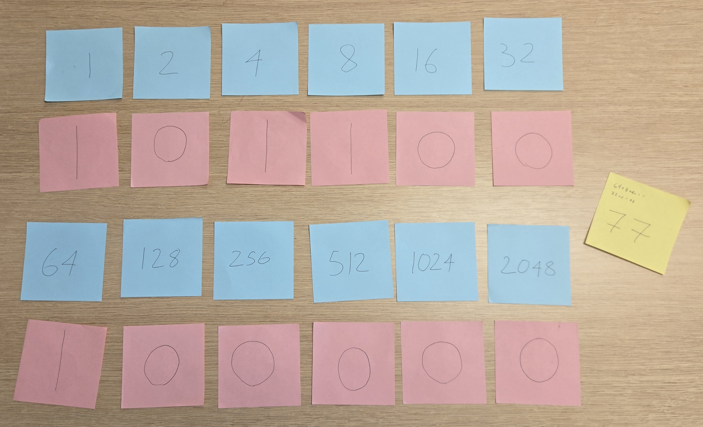

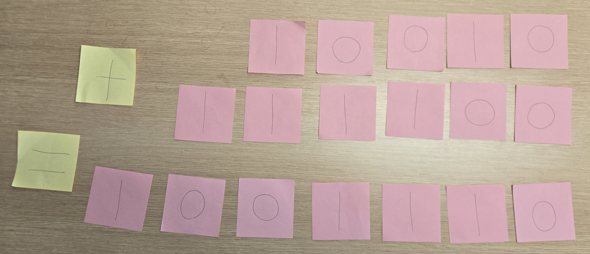{.fragment}

:::

## How computers work

:::{.r-stack}

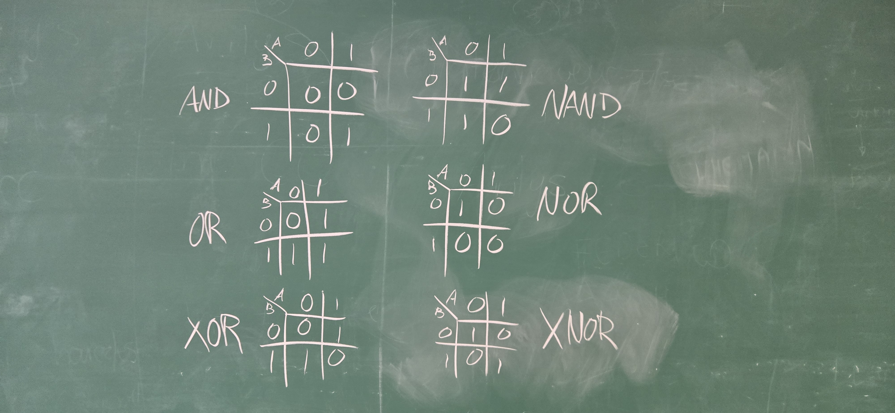

:::{.columns}

:::{.column width=40%}

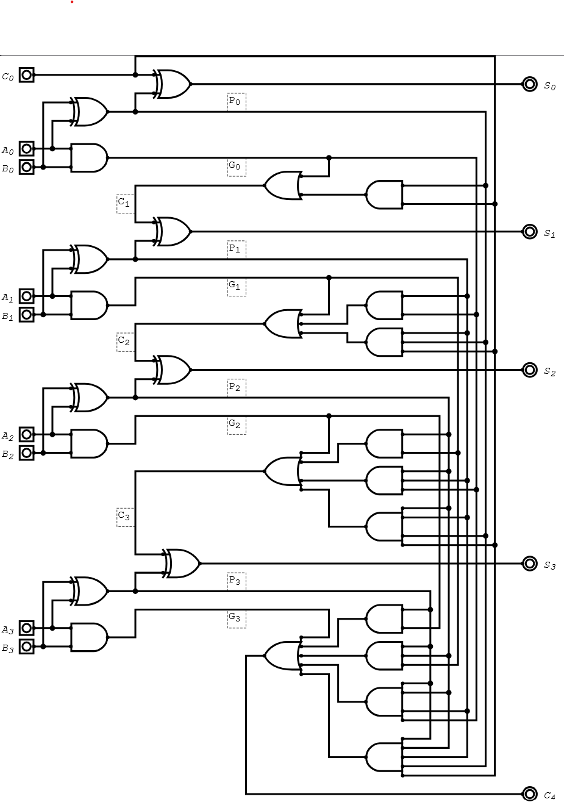{.fragment}

:::

:::{.column width=40%}

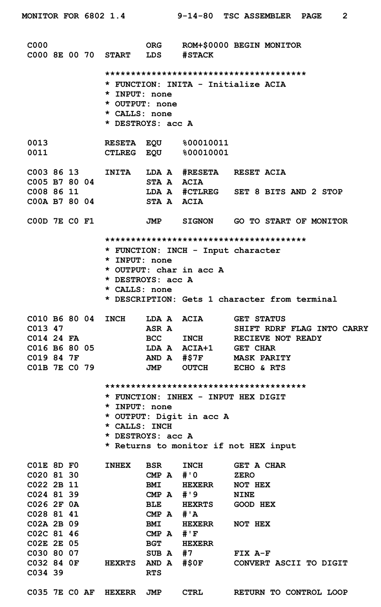{.fragment}

:::

:::

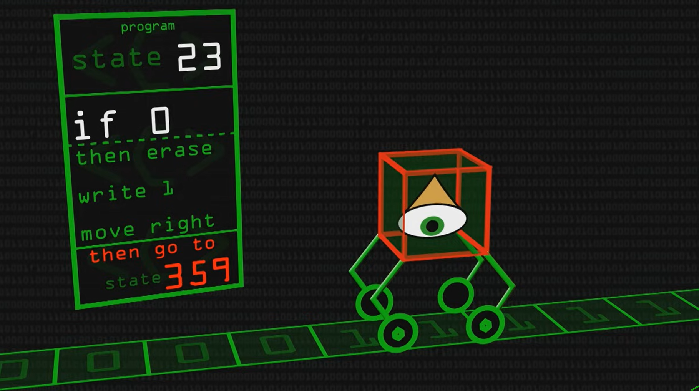{.fragment}

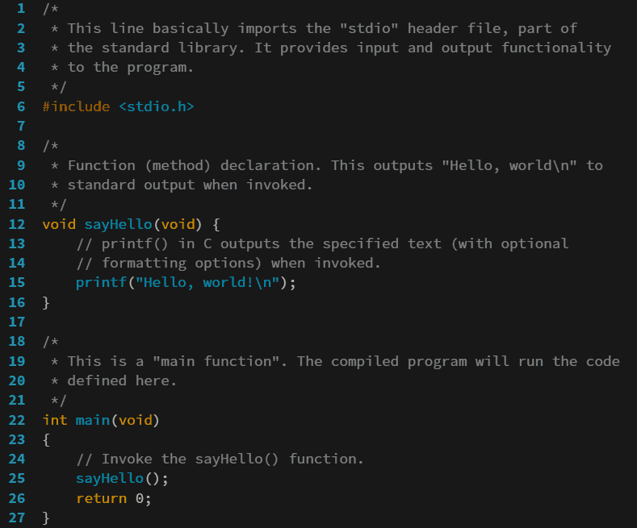{.fragment}

:::

## Pseudocode

:::{.r-stack}

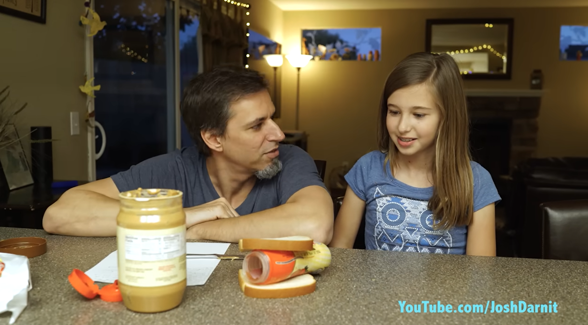

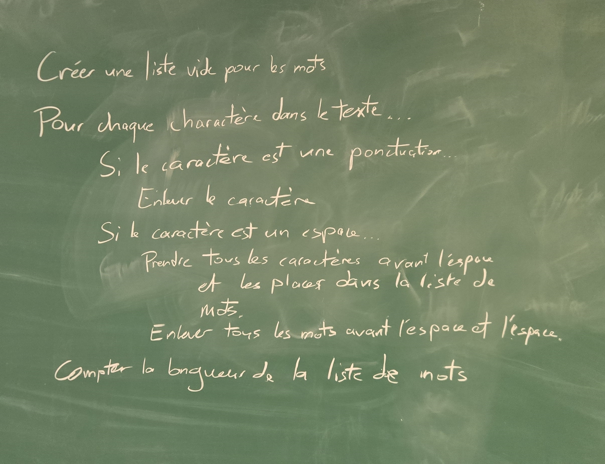{.fragment}

:::

## Ontology

:::{.r-stack}

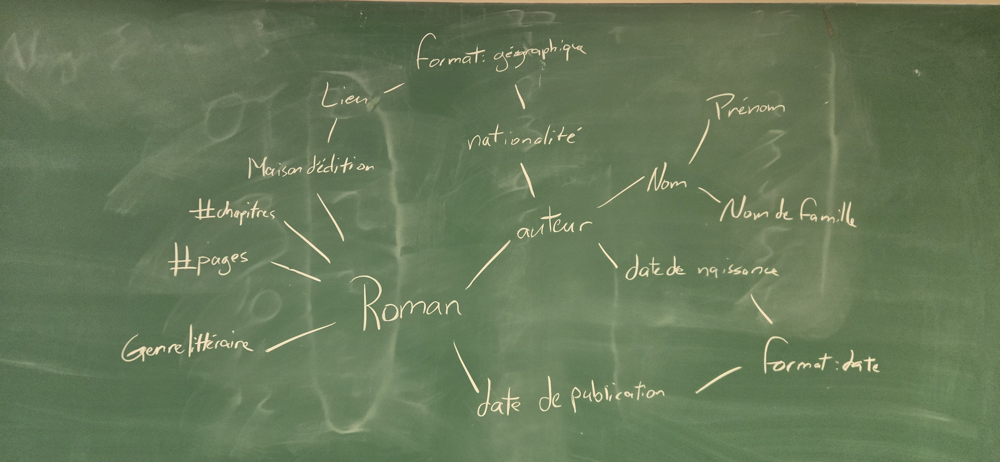

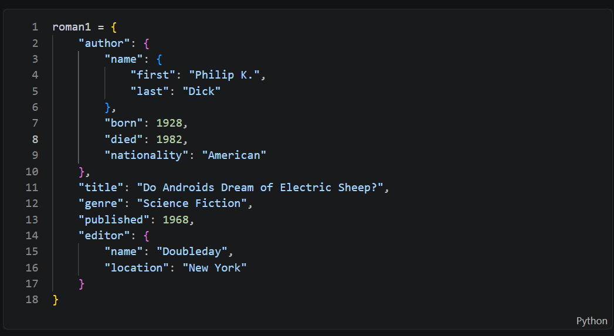{.fragment}

:::

## The language of programming

- Variables:
	- Types;
	- Lists.
- Formal logic;
- Conditional statements;
	- if ... elif ... else.
- Loops:
	- for;
	- while (avec mise en garde);
    - Nested loops.
- Program states.

## Syntax

:::{.r-stack}

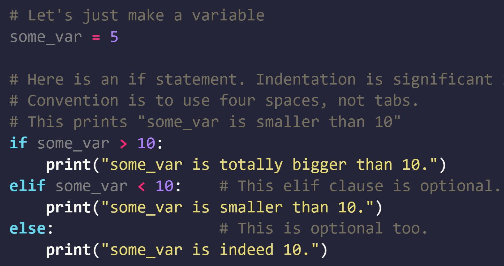

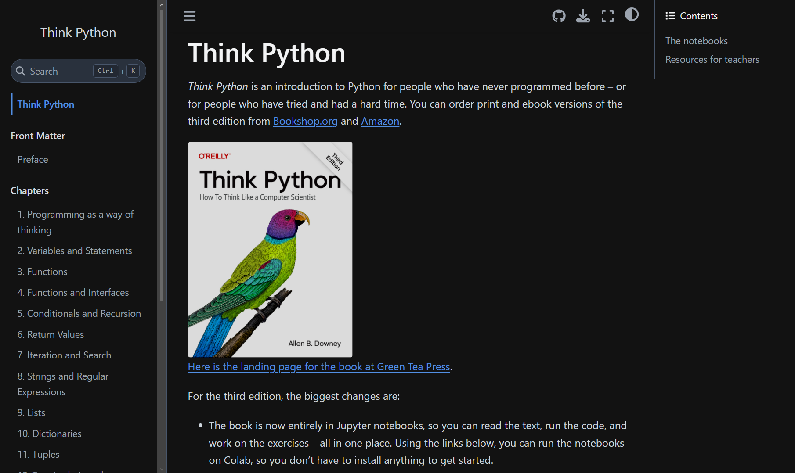{.fragment}

:::

## Syntax (Functions and Objects)

:::{.r-stack}

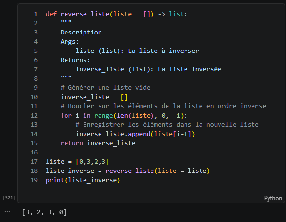

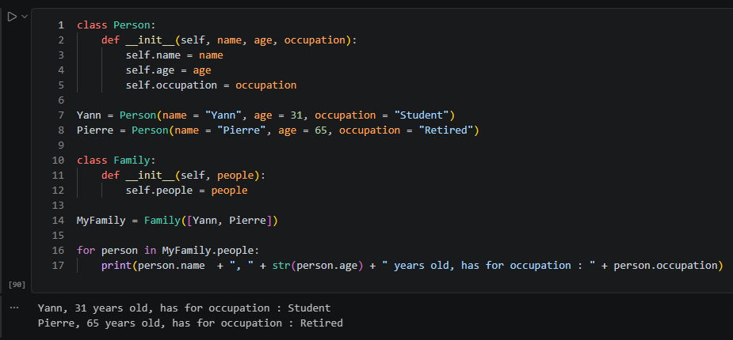{.fragment}

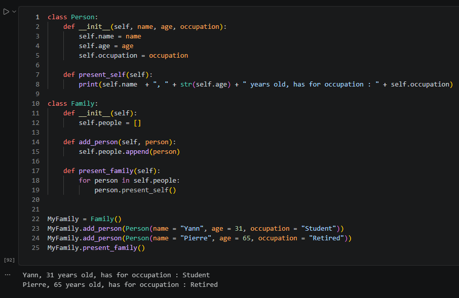{.fragment}

:::

## The Monster

```python
# Créez une variable qui contient un mot
a word = 'hello"
# Créez une autre variable qui contient un autre mot
another_word = "world";
# Imprimez les deux mots séparés par un espace
print[a word + " " another_word)
# Si le deuxième mot est "world", imprimez "Your word is "world"!", sinon changez le premier mot pour "new_word!".
if another_word = "world"
    print("Your word is "world"!")
elif: 
    a word == "new word!"
print(a word)
# Déterminez pourquoi le mot n'a pas changé
# Créez une liste vide
list = ()
# Ajoutez les nombres de 0 à 3 dans la liste en utilisant une boucle
for i range(4)
    list.apend(i)
# Imprimez le dernier élément de la liste
Print(list[4])
# Créez une variable qui contient un nombre entier
1Nombre = 132
# Imprimez le second caractère de la variable en base 10
print(1Nombre[0])
# Importez le module de mathématiques
import mathh
# Imprimez la racine carrée de 132 en utlisant le module mathématique et la variable créée précédemment
print(mathh.squareRoot(1Nombre)
# Créez une variable égale à zéro sans utiliser le chiffre 0
zero_var = # AJOUTEZ VOTRE CODE ICI
# Imprimez le résultat de 132 divisé par la nouvelle variable
print(132 / zero_var)
# Commentez la ligne précédente puisque la division par zéro n'est jamais une bonne idée
# Trouvez le résultat de 10 à la puissance 10
print(10 ^ 10)
# Trouvez le résultat de 10 à la puissance 10 à a puissance 10
print(10 ^ 10 ^ 10)
# Trouvez le moyen d'arrêter le programme parce que c'était une très mauvaise idée d'essayer de calculer 10 à la puissance 10 à la puissance 10
# Commentez la ligne qui demande d'imprimer 10 à la puissance 10 à la puissance 10
# Créez un dictionnaire avec comme clés "key1", "key2", "key3" et comme valeurs les nombres 1, 2 et 3 respectivement
dict = {"key1" 1, "key2": 2; "key3" = 3}
# Imprimez la valeur associée à "key2" dans le dictionnaire
print(dict[key2])
# Imprimez la troisième clé du dictionnaire
print(dict.keys[3])
# Faites crasher votre ordinateur :
ram_breaker = []
while True:
    for i in ram_breaker:
        ram_breaker.append(i)
    print(ram_breaker)
```

## Syntax (Libraries)

:::{.r-stack}

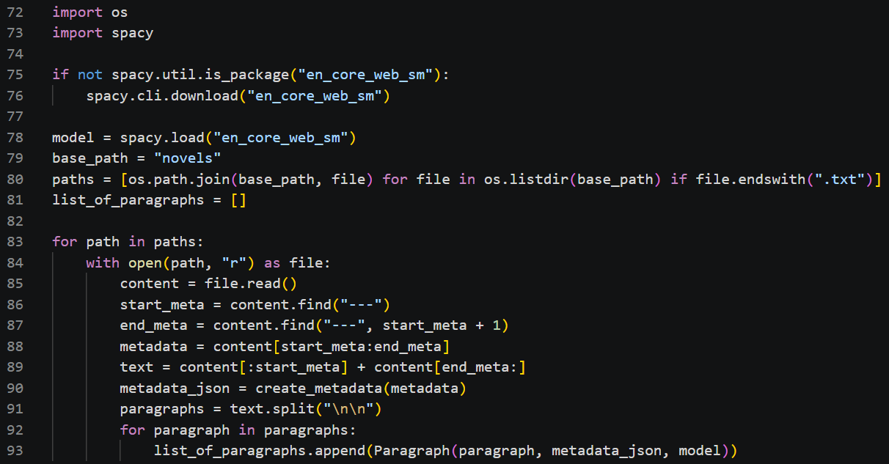

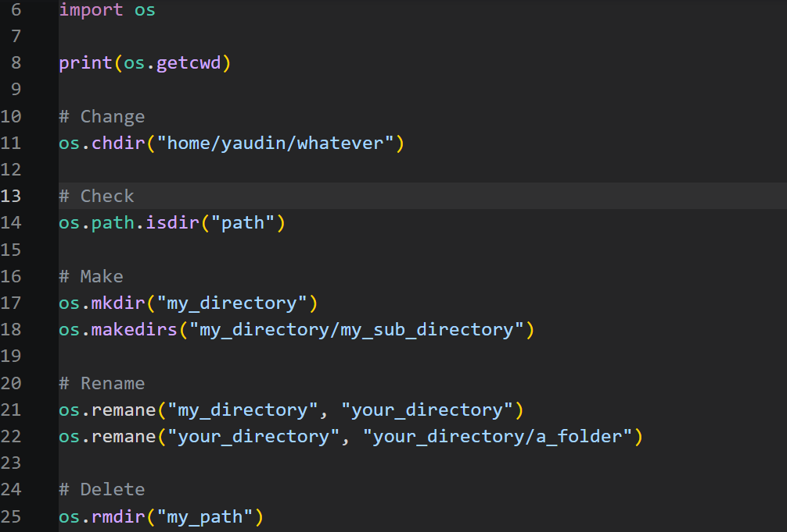{.fragment}

:::

## Assignments

- Pseudocode;
- Translation of a humanities concept into a formal language (Python);
- Free Python project: 
    - Relevant to their work;
    - Makes use of objects and functions;
    - Use at least one library.

# Thinking back and forward{.blue-slide}

## Some quotes

:::{.incremental}

- "I'm trying to trust the process, but the process doesn't trust me." (Student A, *[distressed]*);
- "Why should I ever use an object?" (Student C, *[suspiciously]*);
- "Wait, this is an object?!?!?" (Students while learning about dictionaries, *[saddened]*);
- "You don't need to understand, but you need to know that there is something to understand." (Me, *[mischievously]*);
- "The robot only reads one line at the time, so I'm stuck in loops" (Student B, *[panicked]*)
- "I don't know, you'll have to figure it out for yourself." (Me, *[mostly lying]*);
- "Wait, this is also an object?!?!?"" (Students, while learning spaCy, *[astounded]*);
- "I tried something and it worked in the wrong way." (Student B, *[amused]*).

:::

## Results^[Limited sample size, lack of a control group, other biases, so please don't base your teaching on it.]

Observed:

- Programming as a tool rather than an end;
- De-mythification/mystification of the computer;
- Very creative projects.

Hoped:

- Greater autonomy for the students.

## Conclusion

Syntax *can* be acquired independently outside of class with the ample resources available online (documentation, forums, peers, LLM-powered programming tools...).

The main challenge in teaching programming to humanities students is not and *should not* be technical, but rather conceptual.

# Thank you{.blue-slide}

## Acknowledgement

The author is grateful for the financial support of the following organizations:

- Social Sciences and Humanities Research Council (SSHRC);
- Fond de recherche du Québec (FRQ);
- Laboratoire de recherche sur les écritures numériques.

Credit images: Computerphile, Wikimedia, ThinkPython, LearnXinY, Josh Darnit.

